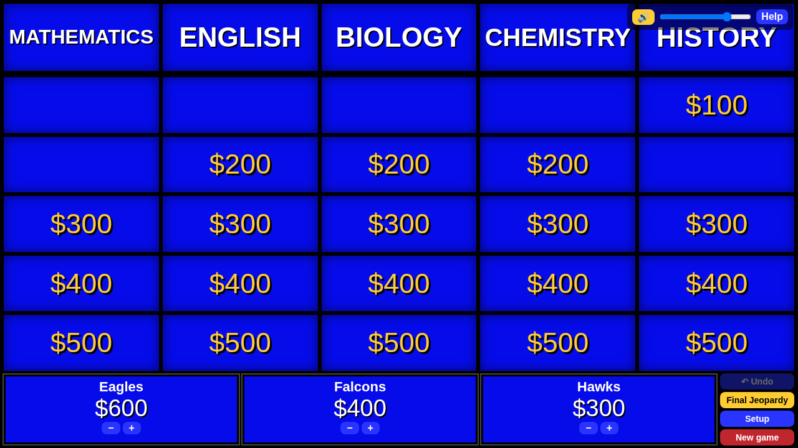
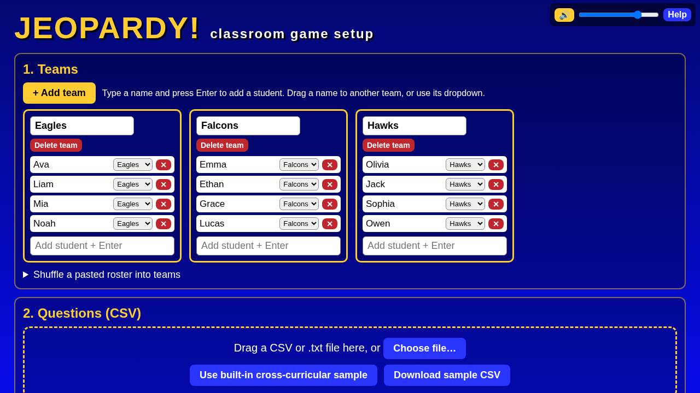
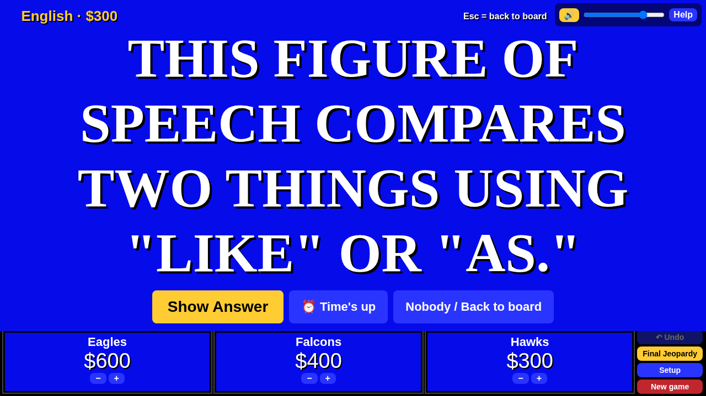
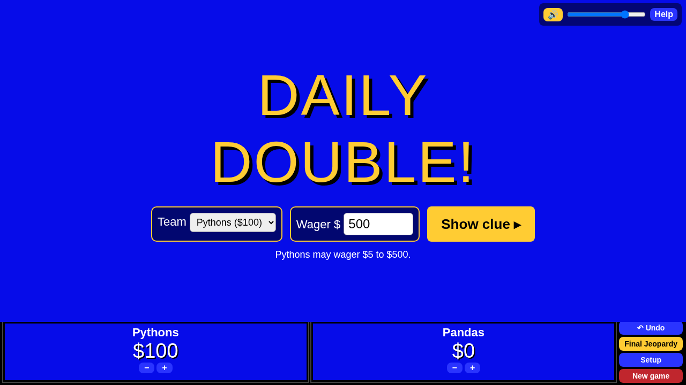
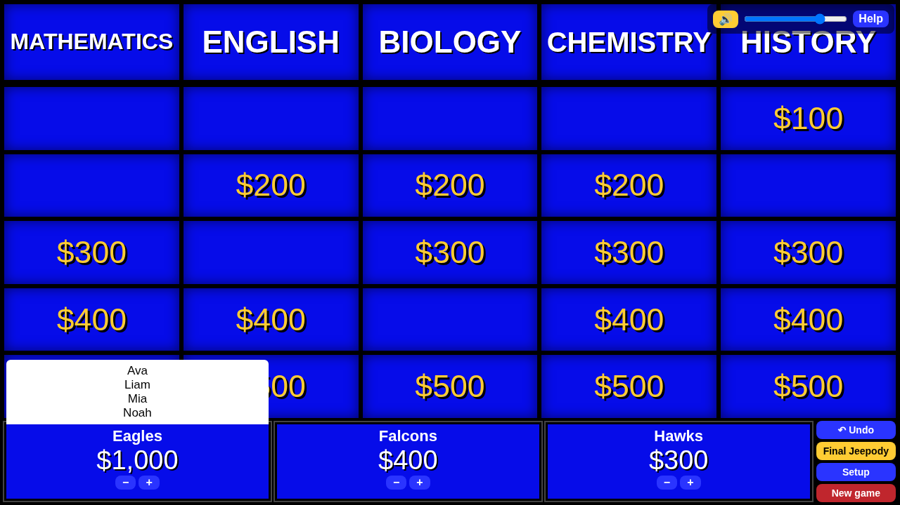

# Jeopardy-Style Review Game

A team quiz game for review days. You load your own questions from a simple spreadsheet file (a **CSV** file, explained below), make teams, and play. Answered squares disappear from the board, and scores update automatically.



**Play online (no download):** https://logosteach.github.io/educational-games/games/jeopardy/jeopardy-app.html

New to downloading files from GitHub? See the step-by-step guide in the [main instructions](../../README.md).

---

## Part 1: Getting started

1. **Get the game.** Use the play-online link above, or download **[jeopardy-app.html](jeopardy-app.html)** (click it, then click the **Download raw file** button, the arrow pointing down).
2. **Open it.** Double-click the downloaded file. It opens in your web browser. Chrome or Edge work best.
3. You'll see the setup screen with **1. Teams** and **2. Questions (CSV)**.



## Part 2: Make teams and add students

1. The game starts with three teams (Team 1, Team 2, Team 3). Click **+ Add team** to add more.
2. To rename a team, click its name box and type a new name.
3. To add a student, type their name in the team's box and press **Enter**. (You can type several names separated by commas, then press Enter.)
4. To move a student, drag their name to another team, or pick a team from the little menu next to their name.
5. Click **✕** next to a name to remove a student. Click **Delete team** to remove a whole team.
6. **Shortcut:** open **Shuffle a pasted roster into teams**, paste your class list, choose how many teams, and click **Shuffle into teams**.

## Part 3: Load your questions

1. In **2. Questions (CSV)**, either drag your CSV file onto the dashed box, or click **Choose file…** and pick it.
2. Don't have one yet? Click **Use built-in Test 3 sample** to try the game, or **Download sample CSV** to get a file you can edit.
3. A green check mark tells you how many categories, clues, and Daily Doubles were found. A red message means something needs fixing (see "Common mistakes" below).
4. Click **Start game**.

## Part 4: Play

1. Click a dollar amount on the board. The clue appears.
2. Read the clue aloud and let teams answer.
3. Click **Show Answer**.
4. Click **✓** for a team that got it right (adds the points) or **✗** for a team that got it wrong (subtracts the points). You can mark more than one team, for example one team misses and another "steals."
5. Click **Nobody / Back to board** (or press **Esc**) to return to the board. That square is now gone.



**Keeping score**

- The **+** and **−** buttons under each team change its score by 100.
- Click a team's name to type an exact score.
- Point at (hover over) a team's name to see its members.
- **Undo** reverses the last award.

**Daily Double**

When a Daily Double square comes up, pick the team that's playing it and type its wager (bet). A team can bet up to its current score, or up to the highest value on the board if its score is lower. Only that team is scored.



**Final Jeopardy**

1. Click **Final Jeopardy** on the right side of the score bar.
2. Reveal the category, then type each team's wager.
3. Reveal the clue. A 30-second timer and thinking music play.
4. Show the answer and mark each team right or wrong.



**Saving and starting over**

- The game saves itself in your browser automatically, so refreshing the page won't lose your scores.
- **Setup** takes you back to the team screen.
- **New game** resets the scores and the board but keeps your teams.
- Click **Help** in the game any time for a quick reminder of these steps.

---

## Part 5: Make your own game with a CSV file

### What is a CSV file?

**CSV** stands for "comma-separated values." It's a very simple spreadsheet saved as plain text.

- Each **row** (line) is one clue.
- **Commas** separate the columns.
- The first row is the **header row**. It names the columns.

Opened in a spreadsheet app, it looks like a normal table. Opened in a text editor, it looks like this:

```
category,value,clue,answer,daily_double
Mathematics,100,The angles of a triangle add up to this many degrees.,What is 180?,no
```

### How to open a CSV file

First, download a sample: open the [samples](samples/) folder, click a **.csv** file, and click **Download raw file**. (Or click **Download sample CSV** inside the game.)

- **Microsoft Excel:** double-click the CSV file, or open Excel and choose **File > Open** and pick the file.
- **Google Sheets** (free, online): go to sheets.google.com, open a blank spreadsheet, choose **File > Import > Upload**, pick the file, and click **Import data**.
- **Numbers** (Mac): right-click the file, choose **Open With > Numbers**.
- **Text editor:** right-click the file and open it with **Notepad** (Windows) or **TextEdit** (Mac). You'll see the plain text with commas. This works, but a spreadsheet app is easier.

### What each column means

| Column | What to type | Required? |
|--------|--------------|-----------|
| **category** | The topic shown at the top of a board column, like *Mathematics*. | Yes |
| **value** | The points for that clue, like 100 or 200. | No. If blank, the game uses 200, 400, 600, 800, 1000 in row order. |
| **clue** | What you read to the students. | Yes |
| **answer** | The correct response. | Yes |
| **daily_double** | Type **yes** to make this clue a Daily Double. Otherwise type **no** or leave it blank. | No |

Example as a table:

| category | value | clue | answer | daily_double |
|----------|-------|------|--------|--------------|
| Mathematics | 100 | The angles of any triangle add up to this many degrees. | What is 180? | no |
| Mathematics | 200 | In y = mx + b, this letter is the slope. | What is m? | yes |
| Biology | 100 | The "powerhouse of the cell." | What is the mitochondria? | no |
| final:World History | | This document was signed in 1215. | What is the Magna Carta? | |

The last row is the **Final Jeopardy** clue. Type **final** in the category column, or **final:** followed by a category name (like *final:World History*) to show that name to students.

### Step by step: build your own game

1. **Copy a sample.** Download one of the sample CSV files and open it in Excel, Google Sheets, or Numbers.
2. **Save a copy under a new name** right away (for example *my-review-game*) so you keep the original.
3. **Leave the first row alone.** It must stay exactly: `category, value, clue, answer, daily_double`.
4. **Type your categories, clues, and answers** over the sample ones. Keep all the clues for one category together, from easiest (lowest value) to hardest.
5. **Mark Daily Doubles** by typing **yes** in the daily_double column.
6. **Add a Final Jeopardy row** (optional) with **final** or **final:Category Name** as the category.
7. **Save it as a CSV file:**
   - **Excel:** **File > Save As**, then in the file type list choose **CSV UTF-8 (Comma delimited) (\*.csv)**, then **Save**. If Excel warns that some features will be lost, click **Yes** / **Keep current format**.
   - **Google Sheets:** **File > Download > Comma-separated values (.csv)**. The file goes to your Downloads folder.
   - **Numbers:** **File > Export To > CSV…**, then **Next** and **Export**.
8. **Load it in the game** (Part 3 above) and check the green message.

### Tips

- Keep the header row exactly as it is.
- The board holds up to **6 categories** with up to **5 clues** each. Extra ones are skipped.
- Use **final** or **final:Name** for Final Jeopardy (one row).
- Type **yes** for a Daily Double. You can have more than one.
- Commas inside a clue are fine when you use a spreadsheet app. It handles them for you when saving. (If you type in Notepad or TextEdit, put the clue in double quotes, like `"Hello, world"`.)
- Text between backticks (\`like this\`) shows up as code, handy for programming classes.
- The game also accepts a **.txt** file in the same format.

### Common mistakes

- **Saved as .xlsx, .numbers, or a Google Sheet instead of .csv.** The game only reads CSV (or .txt). Use the "save as CSV" steps above.
- **Header row changed or deleted.** The game needs the columns category, clue, and answer, or it shows an error.
- **A clue or answer left blank.** That row is skipped (the game tells you which row).
- **Category names spelled differently**, like "Biology" and "biology ". The game treats them as two different categories.
- **More than 6 categories or more than 5 clues in one category.** The extras are skipped.
- **Strange symbols instead of accented letters or quotes.** In Excel, save as **CSV UTF-8**, not plain CSV.

---

## Playing in an online class (Zoom, Adobe Connect, Google Meet)

Open the game in its own browser tab, then share **that tab** (or the browser window):

- **Zoom:** Share Screen > choose the browser window. Check **Share sound** so students hear the sound effects.
- **Adobe Connect:** in a Share pod, choose Share My Screen > Applications or Windows > your browser.
- **Google Meet:** Present now > A tab > pick the game tab (tab sharing includes sound).

## Troubleshooting

- **The CSV won't load:** check the first row is the header and the file was saved as CSV (see Part 5).
- **Missing squares:** each category can have only 5 clues, and only 6 categories fit.
- **No sound:** click anywhere on the page once (browsers block sound until you click), make sure the 🔊 button at the top right is not muted, and turn on sound sharing in your meeting app.
- **Start fresh:** click **New game**, or clear your browser's site data.
- **Something looks odd in Safari or Firefox:** try Chrome or Edge.

## Disclaimer

This is an independent educational tool. It is not affiliated with, endorsed by, or sponsored by *Jeopardy!*, Jeopardy Productions, Inc., or Sony Pictures Television. *Jeopardy!* is a registered trademark of its owner.

## License

MIT. Free to use, copy, change, and share. See the [LICENSE](../../LICENSE) file.
